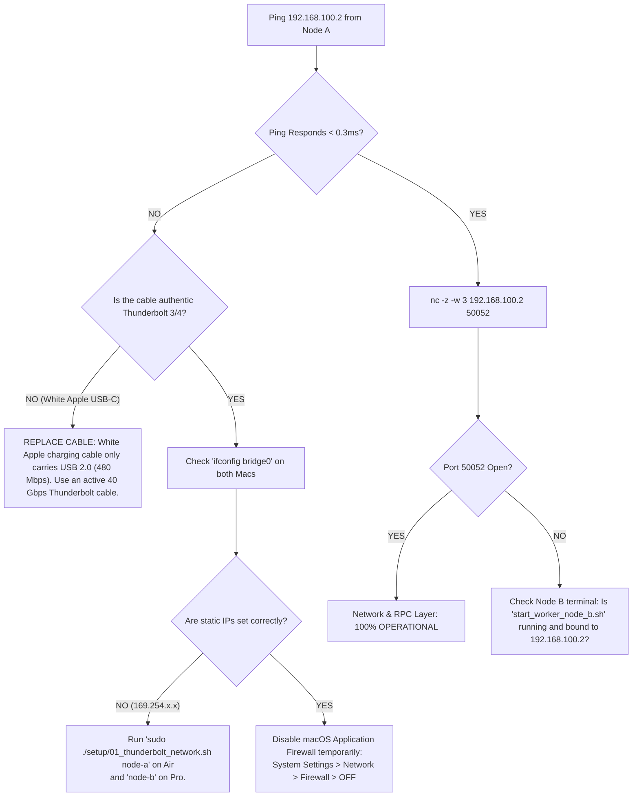
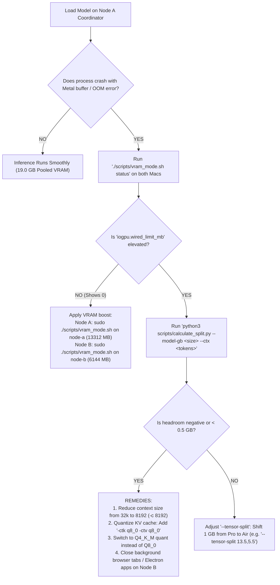
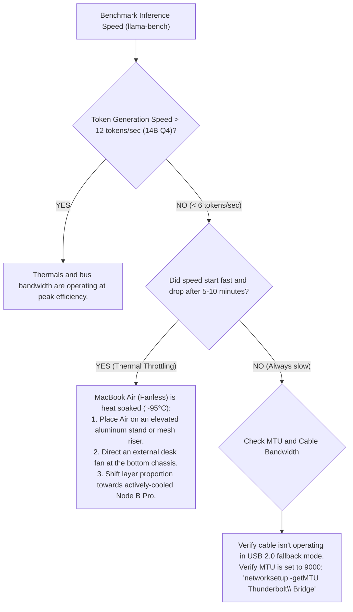

# The Foolproof Offline AI Cluster Handbook: Dual-Mac M2 Edition

An exhaustive operational guide, troubleshooting manual, edge-case playbook, and architectural reference for clustering an **Apple Silicon M2 MacBook Air (16 GB)** and an **M2 MacBook Pro (8 GB)** into a unified **19.0 GB Usable VRAM** offline inference engine.

---

## 1. Diagnostic Decision Trees

### 1.1 Network Interconnect Diagnostic Tree



---

### 1.2 VRAM & Memory Allocation Diagnostic Tree



---

### 1.3 Thermal & Performance Diagnostic Tree



---

## 2. Pre-Flight Air-Gap Checklist (Before Disconnecting the Internet)

Before severing internet connectivity or taking the cluster into the field, execute this 5-point verification:

- [ ] **1. Compile Binaries on Both Machines**:
  Verify that `llama-server`, `rpc-server`, and `llama-bench` exist in `llama.cpp/build/bin/` on both the Air and the Pro. Verify with:
  ```bash
  otool -L llama.cpp/build/bin/llama-server | grep -E 'Metal|Accelerate'
  ```
  *(Must show dynamic linkage to Apple Metal framework).*
- [ ] **2. Download and Verify GGUF Models**:
  Verify model file integrity with `shasum -a 256 <model>.gguf`. Ensure the model resides in `~/mac-ai-cluster/models/` on **Node A only**.
- [ ] **3. Pre-Package Offline Python Wheels (If using Exo)**:
  Run while online:
  ```bash
  ./setup/bundle_offline_dependencies.sh download
  ```
  Verify that `.whl` files exist in `offline_wheels/`.
- [ ] **4. Pre-Cache Hugging Face Models (If using Exo)**:
  Run while online:
  ```bash
  ./setup/bundle_offline_dependencies.sh cache-model mlx-community/Qwen2.5-14B-Instruct-4bit
  ```
- [ ] **5. Test Thunderbolt Cable Hardware Negotiation**:
  Plug the cable into both Macs and run on either Mac:
  ```bash
  system_profiler SPThunderboltDataType | grep -A 5 "Link Status"
  ```
  *(Must show `Link Status: 0x2` or `Speed: Up to 40 Gb/s`).*

---

## 3. Exhaustive Troubleshooting & "What If It Doesn't Work?"

### Issue 1: "Thunderbolt Bridge" does not appear in Network Settings
* **Symptom**: `networksetup -listallnetworkservices` does not list `Thunderbolt Bridge`, or the adapter is marked red/inactive.
* **Root Cause**: macOS unloads the Thunderbolt Bridge profile when neither an external display nor a peer Mac is detected during boot.
* **Foolproof Solution**:
  1. Unplug the cable, wait 3 seconds, plug firmly into the left-side Thunderbolt port of both Macs.
  2. Manually initialize the service via terminal:
     ```bash
     sudo networksetup -createnetworkservice "Thunderbolt Bridge" bridge0
     ```
  3. Run `sudo ./setup/01_thunderbolt_network.sh node-a` (or `node-b`).

---

### Issue 2: Ping Fails or Destination Host Unreachable (`192.168.100.2`)
* **Symptom**: `ping 192.168.100.2` returns `Request timeout for icmp_seq 0` or `Host is down`.
* **Root Cause**: IP address collision with an existing local router subnet, or the macOS packet filter is blocking non-Wi-Fi interfaces.
* **Foolproof Solution**:
  1. Flush ARP tables and cycle the virtual bridge interface:
     ```bash
     sudo arp -d -a
     sudo ifconfig bridge0 down
     sudo ifconfig bridge0 up
     ```
  2. Verify that both machines are on the identical subnet:
     * Node A must be `192.168.100.1` netmask `255.255.255.0`
     * Node B must be `192.168.100.2` netmask `255.255.255.0`
  3. Disable macOS Application Firewall:
     * System Settings > Network > Firewall > Toggle OFF (isolated Thunderbolt cables present zero network security risk).

---

### Issue 3: `llama-server` Fails with `GGML_ASSERT(gpu_mem >= required_mem)` or Metal Out-of-Memory
* **Symptom**: Coordinator starts, loads 20 layers, then crashes with an error allocating Metal buffers on the remote RPC worker.
* **Root Cause**: Node B (M2 Pro 8GB) has ~1.5 GB less free memory than expected due to background apps (Discord, Chrome, Slack, WindowServer), causing its allocated layer share to exceed physical VRAM.
* **Foolproof Solution**:
  1. Purge memory on Node B:
     ```bash
     sudo purge
     ```
  2. Run the dynamic memory optimizer to lift the 75% cap to 6.0 GB:
     ```bash
     sudo ./scripts/vram_mode.sh on node-b
     ```
  3. Re-calculate your split and shift 1–2 layers back to Node A:
     ```bash
     # Instead of 13.0,6.0:
     ./scripts/start_coordinator_node_a.sh ~/mac-ai-cluster/models/qwen.gguf 8192 13.5,5.5
     ```
  4. Enable quantized KV cache to slash context memory by 50–75%:
     * Pass `-ctk q8_0 -ctv q8_0` to the launch command.

---

### Issue 4: MacBook Pro Sleeps in Clamshell Mode (Worker Drops Connection)
* **Symptom**: You start the worker on the MacBook Pro, close the lid to use it as a headless server, and Node A immediately loses connection.
* **Root Cause**: macOS requires specific power and display assertions to stay awake with the lid closed.
* **Foolproof Solution**:
  1. The MacBook Pro **must be connected to AC power** (MagSafe or USB-C PD). macOS will never stay awake in clamshell mode on battery.
  2. Enforce sleep prevention flags:
     ```bash
     sudo pmset -a disablesleep 1
     sudo pmset -a sleep 0
     sudo pmset -a tcpkeepalive 1
     ```
  3. If you want permanent clamshell operation without terminal intervention, install the provided LaunchDaemon:
     ```bash
     cp services/com.cluster.rpcworker.plist ~/Library/LaunchAgents/
     launchctl load ~/Library/LaunchAgents/com.cluster.rpcworker.plist
     ```

---

### Issue 5: MacBook Air Thermally Throttles (Performance Drops 50%+)
* **Symptom**: Prompt ingestion starts at 60 tokens/sec, but generation slows from 18 t/s down to 7 t/s after 10 minutes of continuous chat.
* **Root Cause**: The M2 MacBook Air has a fanless passive cooling design. The aluminum chassis can only dissipate ~10–12W passively before reaching 95°C and reducing GPU clocks. The MacBook Pro has an active fan and can sustain 25W indefinitely.
* **Foolproof Solution**:
  1. **Asymmetric Offload**: Give the MacBook Pro (Node B) a slightly higher share of compute layers (e.g. `--tensor-split 12.0,6.0` instead of `13.5,5.5`).
  2. **Physical Elevation**: Lift the bottom chassis of the MacBook Air off the desk using an aluminum stand. Even 1 inch of bottom airflow reduces temperatures by 8–12°C.
  3. **Thread Clamping**: Keep CPU threads set to `-t 4` (Performance cores only). Spilling onto efficiency cores generates excess heat with near-zero inference speedup.

---

### Issue 6: `llama.cpp` Rejects `--rpc` Flag with "unrecognized option"
* **Symptom**: Executing `llama-server --rpc 192.168.100.2:50052` prints `unknown argument: --rpc`.
* **Root Cause**: `llama.cpp` was compiled with standard flags without enabling the RPC backend.
* **Foolproof Solution**:
  Recompile using our turnkey build script:
  ```bash
  cd ~/mac-ai-cluster
  ./setup/02_build_llamacpp.sh
  ```
  *(This explicitly enforces `-DGGML_RPC=ON -DGGML_METAL=ON`).*

---

### Issue 7: Exo Fails Offline with `huggingface_hub` Connectivity Errors
* **Symptom**: Running `exo` while offline prints:
  `requests.exceptions.ConnectionError: Could not reach huggingface.co`.
* **Root Cause**: Exo attempts to query the Hugging Face repository API to verify tokenizer files and metadata.
* **Foolproof Solution**:
  1. Enforce strict offline environment variables:
     ```bash
     export HF_HUB_OFFLINE=1
     export TRANSFORMERS_OFFLINE=1
     export HF_DATASETS_OFFLINE=1
     ```
  2. Pre-cache the exact model while online using:
     ```bash
     ./setup/bundle_offline_dependencies.sh cache-model mlx-community/Qwen2.5-14B-Instruct-4bit
     ```

---

### Issue 8: Ethernet Fallback Packet Drops / Slow Speed
* **Symptom**: Connecting via USB-C Ethernet adapters results in stuttering responses or `Connection reset by peer`.
* **Root Cause**: MTU mismatch. Node A is set to MTU 9000 (Jumbo Frames), while the USB adapter on Node B only supports MTU 1500, causing packet fragmentation and drops.
* **Foolproof Solution**:
  Synchronize MTU to 1500 across both Ethernet adapters:
  ```bash
  # On Node A:
  sudo networksetup -setMTU "USB 10/100/1000 LAN" 1500
  # On Node B:
  sudo networksetup -setMTU "USB 10/100/1000 LAN" 1500
  ```

---

## 4. Offline Integration Guide: Connecting Frontends

Because the coordinator serves an OpenAI-compatible REST API at `http://192.168.100.1:8080/v1` (or `http://localhost:8080/v1` on Node A), you can connect any offline UI:

### 4.1 OpenWebUI (Docker or Native)
1. In OpenWebUI Settings > Connections:
   * **OpenAI API Base URL**: `http://192.168.100.1:8080/v1`
   * **API Key**: `sk-no-key-required`
2. Save connection. All loaded cluster models appear immediately in the model dropdown.

### 4.2 Obsidian Smart Connections / DeepSeek Journal
In Obsidian's local AI plugin settings:
* **Custom API URL**: `http://192.168.100.1:8080/v1/chat/completions`
* **Model Name**: Enter the exact filename of your GGUF (e.g. `qwen2.5-14b-instruct-q4_k_m.gguf`).

### 4.3 VS Code / Continue.dev (Offline Coding Copilot)
In `~/.continue/config.json`:
```json
{
  "models": [
    {
      "title": "M2 Mac Cluster (Qwen 14B Coder)",
      "provider": "openai",
      "model": "qwen2.5-coder-14b-instruct",
      "apiBase": "http://192.168.100.1:8080/v1"
    }
  ]
}
```

### 4.4 eLlama Native Desktop Integration
You can use the local **eLlama** native desktop application (from `C:\Users\T450\Utilities\eLlama`) on macOS:
1. Open eLlama on macOS.
2. In Settings > Backend, point eLlama to use `llama-server`.
3. In Advanced Arguments, add `--rpc 192.168.100.2:50052 --tensor-split 13.0,6.0`.
4. Launch any GGUF model directly with native macOS UI controls!

---

## 5. Frequently Asked Questions (FAQ)

#### Q1: Can I connect an M1 or M3/M4 Mac to this M2 cluster?
**Yes.** `llama.cpp` RPC and `exo` are completely architecture-heterogeneous. You can pool an M1 MacBook Air (8 GB) with an M4 Max (64 GB). The `--tensor-split` parameter simply divides the layer tensors proportionally according to each node's available memory.

#### Q2: Why does the model file only need to be stored on the MacBook Air?
`llama.cpp` RPC implements remote tensor execution, not remote file serving. Node A loads the entire GGUF file from its local SSD into memory, partitions the computation graph, and transfers Node B's layers across the 40 Gbps Thunderbolt connection during the initial 3-second startup phase. Node B does not require local disk space for the weights.

#### Q3: What happens if the Thunderbolt cable is accidentally unplugged during generation?
`llama-server` on Node A will encounter a broken TCP pipe error on port 50052 and abort the current generation. It will **not** corrupt your model file or damage your macOS system. Once re-plugged, simply re-run `start_worker_node_b.sh` and restart the coordinator.

#### Q4: Why can't I use Wi-Fi instead of Thunderbolt?
Wi-Fi 6 latency hovers between 8 ms and 25 ms with high jitter. Because autoregressive token generation requires an inter-node network round-trip for *every single token generated*, a 15 ms network penalty per token caps generation speed at roughly 1–2 tokens per second regardless of how fast the M2 GPUs are. Thunderbolt's < 0.15 ms latency maintains full native GPU generation speeds (> 18–25 tokens/sec).

#### Q5: Can I run this cluster entirely on battery power in a park or airplane?
**Yes.** Both the M2 Air and M2 Pro are laptops. With a direct Thunderbolt 3/4 cable connected between them, the link establishes peer-to-peer with zero router, modem, or internet required. *Note: Battery life will be approximately 2–3.5 hours under continuous heavy inference.*

#### Q6: Does closing the terminal window on Node B stop the worker?
If running interactively via `./scripts/start_worker_node_b.sh`, closing the window terminates the process and triggers the auto-cleanup trap. If you install the LaunchAgent [`com.cluster.rpcworker.plist`](file:///C:/Users/T450/.gemini/antigravity/scratch/mac-ai-cluster/services/com.cluster.rpcworker.plist), Node B runs permanently in the background even if no terminal is open.

#### Q7: How do I change the model without restarting the worker on Node B?
You do **not** need to touch Node B! The worker is a stateless compute engine. To change models, simply terminate `start_coordinator_node_a.sh` on Node A (`Ctrl+C`) and re-run pointing to a different GGUF model:
```bash
./scripts/start_coordinator_node_a.sh ~/mac-ai-cluster/models/gemma-2-27b-it-q3_k_m.gguf 8192
```
Node A will automatically clear Node B's previous tensors and stream the new model's layers.
